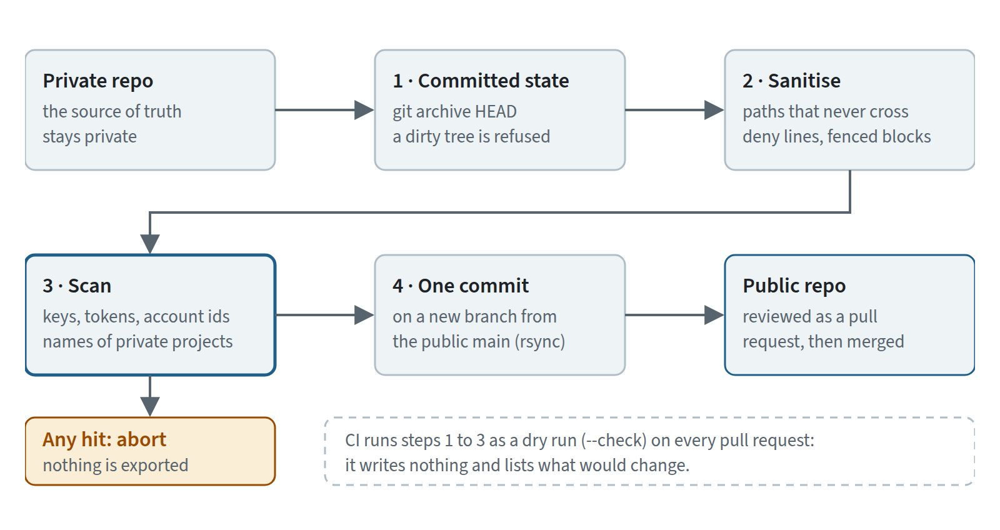
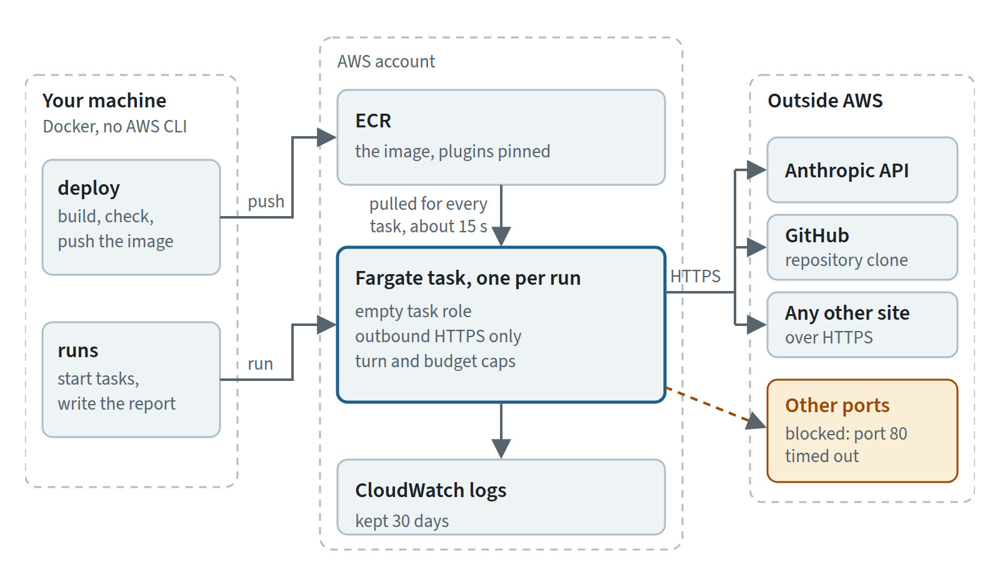
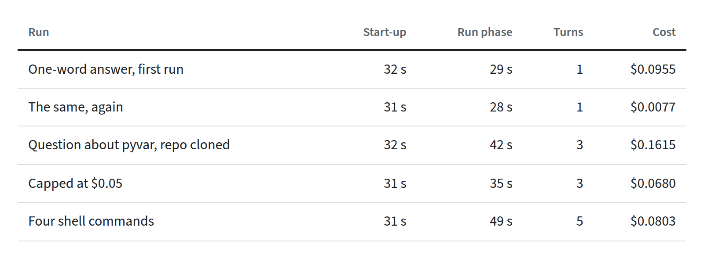
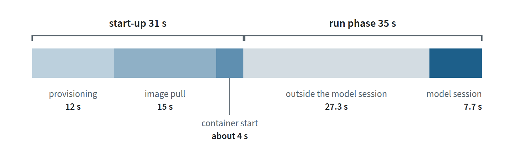
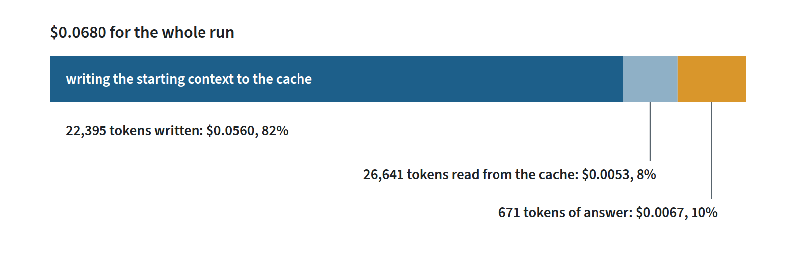
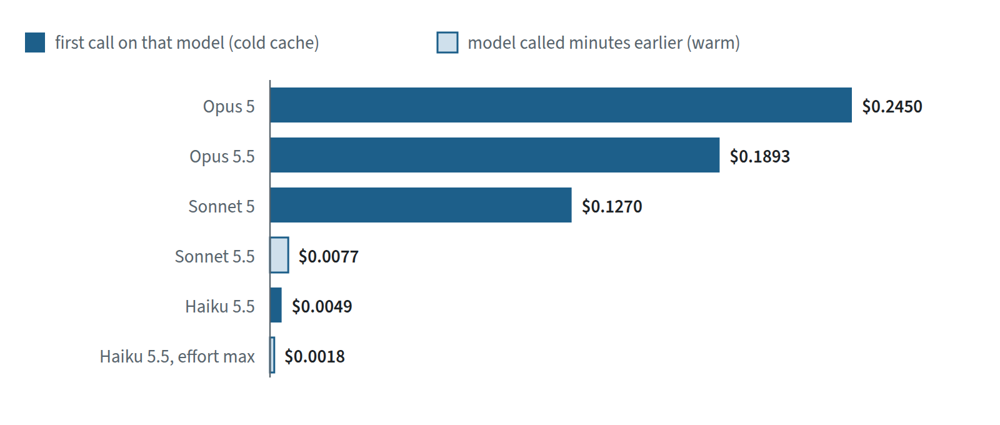
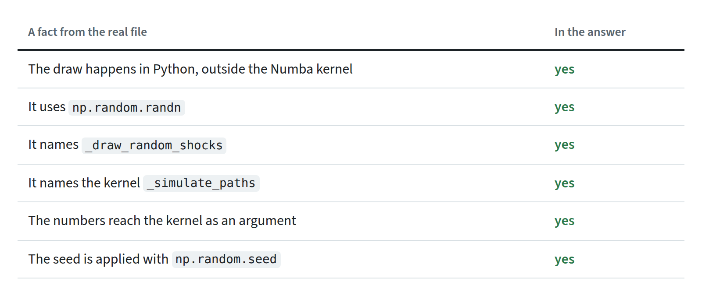
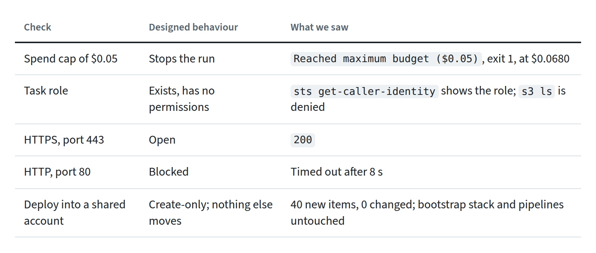

# Stop Mirroring Your Private Repo. Export It. (Plus the First Numbers From Running It on Fargate)

*How claude-docker-public is produced now, and what its first runs on ECS looked like.*


*The Fiery Genius — Ready for Export. AI-generated illustration.*

---

**[claude-docker-public](https://github.com/fibtecltd/claude-docker-public)** is the open-source half of the container setup we run Claude Code in. Until recently it was a mirror of a private repository. It is now an export, and the difference is bigger than the word.

This post has two parts: why we replaced the mirror and how the export works, then what happened the first time we ran the exported design headless on AWS Fargate, with the numbers.

## A mirror's default is "everything crosses"

A mirror copies the private repo and relies on a list of exclusions. Safety is whatever someone remembered to put on that list, and when the list is wrong nothing tells you. We also had a script in each direction, so the two repos were coupled: a change on one side could not be made without thinking about the other.


*The Fiery Genius — Facing Himself in front of a Mirror. AI-generated illustration.*

The public repo also needs files the private one should never have: a licence, a security policy, issue templates. In a mirror those are always one `--delete` away from vanishing.

So we turned it around. **The private repo stays the source. The public repo is a product built from it.**

## What an export does instead

1. **It starts from what is committed.** `git archive HEAD`, not the working directory. A source with uncommitted changes is refused.
2. **It sanitises.** Some paths never cross: the export tooling itself, private deployment settings, profiles that name private projects. Lines matching deny patterns are dropped from the README, and fenced blocks marked as private are cut out. An unbalanced fence aborts the export.
3. **It scans, and aborts instead of warning.** API-key and token shapes, cloud ARNs that carry an account id, and the names of private projects. One hit and nothing is exported.
4. **It writes one commit on a new branch** from the public `main`, with `rsync --checksum --delete` that protects the files that only exist publicly. Review happens as an ordinary pull request on the public side. Exporting the same source twice changes nothing.
5. **CI runs it as a dry run** on pull requests: `--check` writes nothing and lists what would change.


*The export, step by step. Anything the scan finds stops it before anything reaches the public clone.*

One time the scan fired in CI it was on our own test data: a made-up twelve-digit account id inside an ARN in a test fixture. A false positive, and the right kind to have. We changed the fixture, not the rule.

## Then we ran it on Fargate

The exported design runs Claude Code headless on ECS Fargate: one task per run, nothing standing between runs (the idle cost is image storage), plugins baked into the image at pinned commits, a profile that picks which ones load. Every run must carry a turn cap and a budget cap. The task role is empty and the security group allows outbound HTTPS only.


*One task per run. It can reach HTTPS sites, the Anthropic API and GitHub for the clone among them, and nothing else.*

We deployed it into an AWS account that also runs production pipelines, so the deploy script reads before it writes. Nine checks come back GO or NO-GO, the CDK diff must be create-only, `cdk bootstrap` is never run, and afterwards the account is compared with a baseline taken before. Result: 40 new items in the diff, none changed or removed, the bootstrap stack untouched, no pipeline execution started.

## The first numbers

We ran it twice: five runs, then eleven with cost capture. The second set, on the core and pyvar profiles, Fargate on arm64, the image's default model (Sonnet 5.5) unless stated.


*The five runs.*

(Start-up is task created to running, including provisioning and image pull. Cost is Claude Code's own `total_cost_usd`, a client-side estimate of API spend only; Fargate time is billed separately.)


*Where the 66 seconds of the capped run went. Container start is what is left of the 31-second start-up; the model session time is Claude Code's own.*

- **About 32 seconds to a running container** (30 to 36 over all sixteen runs), almost half of it image pull. A one-word task is about a minute from command to exit.
- **There is no warm start.** Fargate pulls the image for every task. The second run was not faster than the first.
- **The run phase is not the model.** A one-word answer took 28 to 30 seconds on every model we tried, Opus and Haiku included. One run reported its own session time: 7.7 seconds inside a 35-second run phase. So most of the run phase is outside the model session: Claude Code and its plugins starting, and exiting.

Each row is one sample. Read these as orders of magnitude, not benchmarks.

## What a run costs

Eleven runs cost **$0.99** against caps that added up to $3.55.

The capped run printed its token counts, and the cost Claude Code reported reproduces from them. It produced 671 output tokens, read 26,641 tokens from the prompt cache and wrote 22,395 to it. At $2 and $10 per million tokens for Sonnet 5.5, with cache writes at 1.25x and cache reads at 0.1x, that is $0.0067 for the answer, $0.0053 for cache reads and $0.0560 for cache writes. They add up to the reported $0.0680. **Eighty-two percent of the cost was writing the starting context. Ten percent was the answer.**

One caveat on that arithmetic. Anthropic's pricing page lists Sonnet 5.5 cache reads at 0.05x, not 0.1x, and Claude Code's figure is an estimate from its own price table. At the page's rates, with five-minute cache writes, the same tokens come to $0.0654, and cache writes are 86 percent of it. The conclusion does not change.


*What the $0.0680 was made of.*

Two consequences:

- **The first call pays, the next ones do not.** A one-word answer cost $0.0955 the first time and $0.0077 both times after, a few minutes later.
- **Set a cap above the starting context.** A cold one-word run already cost more than the $0.05 cap we used for the cap test, so that cap would have stopped any task. The run ended at $0.068, 36 percent over: a cap ends the run after the turn that crosses it, not to the cent.

## Six models, one word

The same prompt on each model, no errors and no rate limits, every one answered `ok` with exit 0:


*The same prompt on six models. Dark bars paid to write the cache; light bars read one written minutes earlier.*

Do not read this as a price list. The cheap rows are the ones with a warm cache; the others paid to write it, so the bar colour matters as much as the length. What it does show: the choice of model moved the cost by more than an order of magnitude, even between two first calls ($0.0049 for Haiku 5.5, $0.2450 for Opus 5), and the run time by about two seconds.

## Did it do the job?

We scored the runs two ways.

**The answer.** The pyvar run asked how the Monte Carlo engine gets its random numbers. We wrote down six facts from the real `engine/montecarlo.py` first: the draw happens in Python outside the Numba kernel, it uses `np.random.randn`, it names `_draw_random_shocks`, it names the kernel `_simulate_paths`, the numbers reach the kernel as an argument, the seed is applied with `np.random.seed`. The answer contained all six, **6 out of 6**, in both of our runs. In the second run every line reference we checked by hand was right. (In the first run one was off by a single line.)


*Six facts from the real `engine/montecarlo.py`, each looked for in the answer.*

That is one question and a pattern match, so it says the agent found the right file in a fresh clone and described it correctly, not that it is good in general.

**The guardrails.** **All eleven runs of the second set behaved as designed.**


*What we designed, and what we saw.*

**What we did not measure:** three tasks at once, Spot, and the answer quality of the models on anything harder than one word.

## Try it

You need Docker and AWS credentials, not the AWS CLI:

```bash
scripts/deploy/ecs-in-docker.sh deploy
scripts/deploy/ecs-in-docker.sh runs
```

The first builds and smoke-tests the image, runs the checks, deploys the stack and pushes the image. The second makes five runs by default and prints the report: timings, cost, the answer scored against the facts above and the guardrail checks. Add `--groups G1,G2,G3,G4` for the eleven runs of this article. The repository and the runbook, with the timing table, are in **[claude-docker-public](https://github.com/fibtecltd/claude-docker-public)**.

## Sources

The measurements are ours: sixteen runs on one AWS account, one sample each, with the scripts that made them and the timing table in the repository. Everything else comes from the pages below, which we checked on 14 October 2026.

**Claude Code and Anthropic**

- [Run Claude Code programmatically](https://code.claude.com/docs/en/headless): headless `claude -p` and `--output-format json`, the `total_cost_usd` field.
- [Track cost and usage](https://code.claude.com/docs/en/agent-sdk/cost-tracking): `total_cost_usd` is a client-side estimate, not billing data; a run that crosses its budget counts the response that crossed it; cache entries last five minutes by default.
- [Prompt caching](https://platform.claude.com/docs/en/build-with-claude/prompt-caching): cache writes at 1.25 times the input price, reads at 0.1 times, with lower read rates on some models.
- [Pricing](https://platform.claude.com/docs/en/about-claude/pricing): the per-model prices behind the cost figures; Sonnet 5.5 at $2 and $10 per million tokens, cache reads at $0.10.

**AWS and tools**

- [Amazon ECS task networking for Fargate](https://docs.aws.amazon.com/AmazonECS/latest/developerguide/fargate-task-networking.html): a task's network interface, security groups, and the public IP a task needs to pull its image without a NAT gateway.
- [AWS CDK bootstrapping](https://docs.aws.amazon.com/cdk/v2/guide/bootstrapping.html): what `cdk bootstrap` provisions, and why the deploy script never runs it.
- [git archive](https://git-scm.com/docs/git-archive): an archive of a named tree, so only what is committed.
- [rsync(1)](https://download.samba.org/pub/rsync/rsync.html): `--checksum` and `--delete`.

**This project**

- [claude-docker-public](https://github.com/fibtecltd/claude-docker-public): the repository.
- [The runbook](https://github.com/fibtecltd/claude-docker-public/blob/main/docs/runbook.md): the timing tables, cost per run, model matrix and findings.
- [`ecs-in-docker.sh`](https://github.com/fibtecltd/claude-docker-public/blob/main/scripts/deploy/ecs-in-docker.sh) and [`first-runs.sh`](https://github.com/fibtecltd/claude-docker-public/blob/main/scripts/run/first-runs.sh): the deploy and the runs, with their tests next to them.
- [`engine/montecarlo.py`](https://github.com/fibtecltd/pyvar/blob/master/engine/montecarlo.py) in [pyvar](https://github.com/fibtecltd/pyvar): the file the pyvar run was asked about. It may have changed since.
- Earlier in this series: [The Sandbox Is the Feature](https://github.com/fibtecltd/claude-docker-public/blob/main/articles/the-sandbox-is-the-feature.md) and [Sonnet 5.5 by Default, Opus 5.5 on Call](https://github.com/fibtecltd/claude-docker-public/blob/main/articles/sonnet-5-5-by-default-opus-5-5-on-call.md).

**Images**

The two illustrations are AI-generated. The tables and diagrams are drawn from the run data above.
