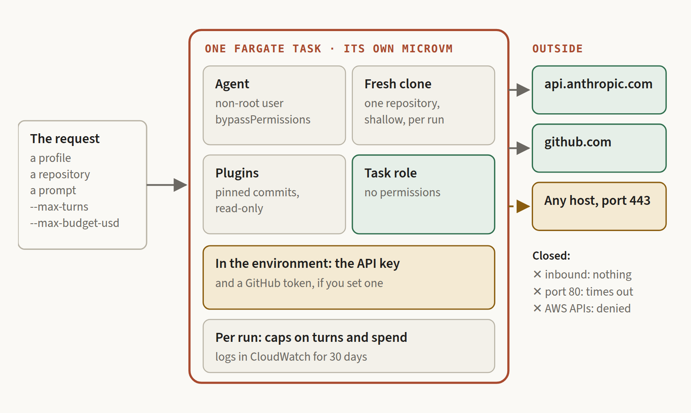
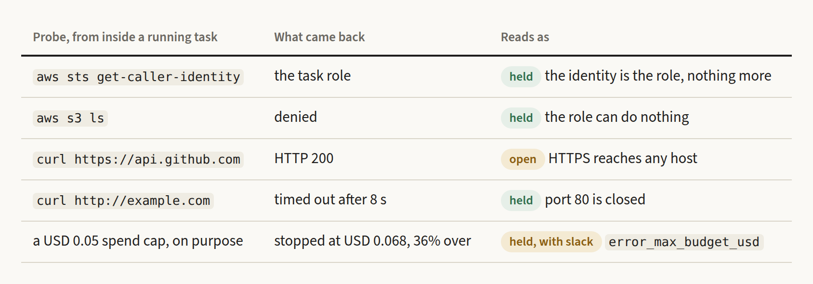
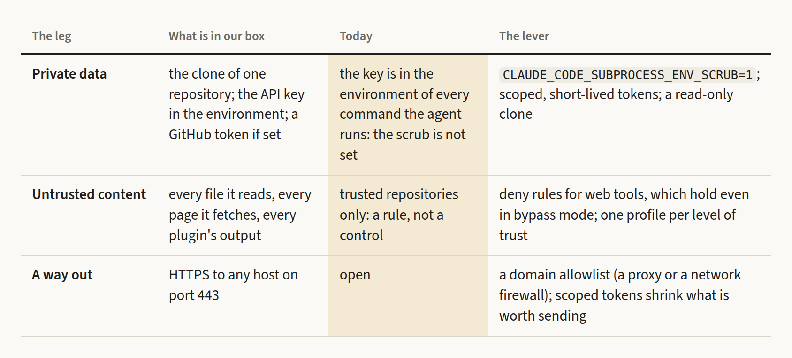
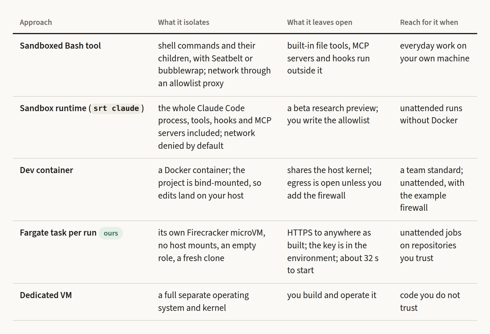

# The Box Is Only Half the Boundary

*What sixteen disposable Claude Code runs taught us about sandboxing coding agents, and three things our own sandbox still doesn't stop.*


*Sand Genius, crated for shipping. AI-generated illustration.*

---

The crate in the picture carries the objection every team hears the first time it sandboxes a coding agent: **"A brilliant mind shouldn't stay confined."**

It is a fair point. An agent that has to ask before every `rm`, every `curl` and every `pip install` is not much of an agent, so teams switch the permission prompts off. Then comes the question that matters: with the prompts gone, what is left between the agent and everything else?

We switched ours off too. The image in **[claude-docker-public](https://github.com/fibtecltd/claude-docker-public)** runs Claude Code with `bypassPermissions`, headless, on AWS Fargate. This post is about what makes that defensible, what we measured to check it, and the three things the box still doesn't stop. Anthropic's own documentation is blunt about the problem underneath: bypass mode "offers no protection against prompt injection or unintended actions." A sandbox can't fix that. It can only decide how far the damage reaches.

## Three questions every agent sandbox answers

Whatever you build it from, a sandbox for an agent is an answer to three questions:

- **What can it touch?** Files, credentials, cloud APIs.
- **What can it send?** Every network path out of the box.
- **What can it spend?** Agents loop, so money and time are resources too.

Anthropic's guide to custom containers asks the first two in its own words: review "what is mounted writable, what credentials and tokens are reachable inside it, and what the network egress policy allows." We add the third, because a runaway agent costs money before it costs anything else.

There is a fourth question, *what can it be told?*, and no sandbox answers it. OWASP files its consequences under LLM06, Excessive Agency: damaging actions taken in response to unexpected, ambiguous or manipulated model output. Its mitigations are about what the agent is given (fewer tools, narrower permissions, authorisation enforced downstream), not about what it is told. Read everything below that way.

## What we built

One image, and one Fargate task per run. A run is an `ecs run-task` call; between runs the only thing we pay for is image storage.

- **A fresh box every time.** Fargate runs each task on its own Firecracker microVM, so a run does not share a kernel with another run and nothing survives it.
- **A non-root user, nothing executed at start.** Claude Code refuses to start in bypass mode as root anyway.
- **No volumes and no host mounts.** The only code in the box is a shallow clone of the one repository named in the request.
- **A task role with no permissions.** Anything inside can sign AWS requests as the task role, and the role is allowed nothing.
- **No inbound rule, and outbound HTTPS only.** One security group, one rule.
- **A pinned supply chain.** Plugins are fetched at the commits in a lock file at build time, owned by root and read-only for the agent. There is no marketplace call at run time, and CI fails the build if a credential is left in the image or its history.
- **Caps on every run.** `--max-turns` and `--max-budget-usd` are required: limits belong to the task, not to the image.


*What is inside the box, and what crosses its edge. Everything on the left of the line is there on purpose.*

## Five things we tried from the inside

We do not trust a diagram of a sandbox, so the test harness (`scripts/deploy/ecs-in-docker.sh runs`) makes the agent try things from inside the box and prints what happened. On 2026-10-14, two of the sixteen runs were guardrail probes: one asks the agent to run four shell commands, the other hits a spend cap on purpose.


*Five probes from inside a running task.*

The first two are the good news. The agent's AWS identity is the task role, and the role can do nothing: `s3 ls` is denied. A hijacked session cannot reach the account around it.

The next two are the honest news. HTTPS to the open internet returns 200. Plain HTTP on port 80 times out after eight seconds. The box blocks protocols, not destinations: a security group cannot say "only `api.anthropic.com`". We come back to that below.

The fifth is a lesson in what a cap is. We set a USD 0.05 budget and the run stopped, correctly, with `error_max_budget_usd`, at USD 0.068. A cap ends the run after the turn that crosses it, not to the cent, so treat it as a ceiling with slack. A cold one-word run on Sonnet 5.5 already costs more than the cap we used for the test (USD 0.0955 for the first call, USD 0.0077 for each later one, because the first call pays to write the prompt cache), so set caps above the starting context, or they will stop even a trivial task.

All sixteen runs behaved as designed. That is a statement about the design. It is not a statement about safety.

What disposability costs: about 32 seconds to a running container (30 to 36 across the sixteen runs, roughly 13 of provisioning and 15 of image pull, with no warm start), so a one-word task takes about a minute from command to exit. For an agent that works for twenty minutes, that is noise. For a quick check, it is the whole job. One sample each, one account, one region: read these as orders of magnitude.

## What the box doesn't stop

**1. The key is in the box.** The API key arrives from Secrets Manager as an environment variable, and with permission prompts off, nothing stops a command the agent runs from reading it. Claude Code has an opt-in setting, `CLAUDE_CODE_SUBPROCESS_ENV_SCRUB=1`, that removes credentials from the environment of the commands it starts (and, on Linux, runs Bash in its own PID namespace so it cannot read the parent's environment through `/proc`). It deliberately leaves `GITHUB_TOKEN` in place so that `gh` keeps working. We do not set it in the image today. Anthropic's dev-container page states the general case plainly: with permissions bypassed, a container does not prevent "exfiltrating anything accessible inside the container, including the Claude Code credentials stored in `~/.claude`."

**2. Anywhere on 443.** Simon Willison's "lethal trifecta" is an agent that has private data, reads untrusted content and can communicate outward. Our box has all three. The private data is the clone and the keys. The untrusted content is every file the agent reads and every page it fetches. The way out is port 443, to anywhere. Anthropic recommends bypass mode "in isolated environments like containers, VMs, or dev containers without internet access"; ours has internet access, because the agent has to reach the model.


*The three legs, what we do about each today, and the lever that would narrow it.*

How small could the allowlist be? In Anthropic's network requirements, a headless run authenticated with an API key needs `api.anthropic.com`. The sign-in hosts are for OAuth, and the telemetry hosts are optional (`CLAUDE_CODE_DISABLE_NONESSENTIAL_TRAFFIC` turns them off). Add `github.com` for our clone and whatever a task installs, and that is two or three hostnames. A security group cannot express a hostname, so the options are a forward proxy (Claude Code honours `HTTPS_PROXY`), a network firewall with domain rules, or DNS-level filtering, which a connection to a bare IP address walks around. None is free. And a short list is not a closed channel: if `github.com` is on it and the token can push, a repository is a place to put data. An allowlist narrows the way out. Scoped tokens narrow what is worth sending.

**3. The prompt and the output are data at rest.** The prompt, the repository name and any `--env` values are part of the run request, so they are visible to anyone who can call `ecs:DescribeTasks` and they appear in CloudTrail. Everything the container prints goes to CloudWatch for 30 days. A workload under a zero-retention rule needs different plumbing: pass a pointer (a path, an object key), not the data, and write results to a store with its own expiry.

## Which sandbox for which job

Anthropic's guide to choosing a sandbox environment lists the options. The short version, with ours next to them:


*Five ways to box an agent. None of them answers "what can it be told?"*

Our local `docker compose` route is a plain container on your machine, which shares your kernel, so it belongs in the same bucket as a dev container: fine for repositories you trust, wrong for code you do not.

## Eight rules before you turn the prompts off

1. **Run as non-root**, and write it into the image. Claude Code will refuse otherwise.
2. **No host mounts you would not hand a stranger.** No `~/.ssh`, no cloud credential files, no Docker socket.
3. **An empty cloud role.** Add permissions per task, never per image.
4. **Scoped, short-lived tokens**, for one repository.
5. **Put the key out of the shell's reach** (the scrub above), or keep it out of the box with a gateway that holds it.
6. **Decide egress on purpose.** Default-deny if you can. If you cannot, write down what can leave.
7. **A cap on every run**, above the context floor, treated as a ceiling with slack.
8. **Probe the box from the inside, in CI, on every build.** A guardrail you do not test is a rumour.

And the rule under all eight: trusted repositories only. The box limits the damage of a bad session. It does not make an untrusted input safe.

## Try it, and tell us where it leaks

```bash
scripts/deploy/ecs-in-docker.sh deploy
scripts/deploy/ecs-in-docker.sh runs
```

You need Docker and AWS credentials, not the AWS CLI. The first command builds and smoke-tests the image, checks the account, deploys the stack and pushes the image; the second runs the probes above and prints a report. The runbook, with every timing and cost, is in **[claude-docker-public](https://github.com/fibtecltd/claude-docker-public)**. `SECURITY.md` lists the known limitations, and this post adds to the list on purpose. If you find another leak, open an issue, or write to the address in `SECURITY.md` if it is a vulnerability.

## Sources

The measurements are ours: sixteen runs on one AWS account in one region, one sample each, with the scripts that made them and the timing table in the repository. Everything else comes from the pages below, which we checked on 29 October 2026.

**Claude Code and Anthropic**

- [Choose a permission mode](https://code.claude.com/docs/en/permission-modes): what `bypassPermissions` does, that it "offers no protection against prompt injection or unintended actions", the advice to use it only in isolated environments without internet access, and that it refuses to start as root.
- [Choose a sandbox environment](https://code.claude.com/docs/en/sandbox-environments): the comparison of the sandboxed Bash tool, the sandbox runtime, dev containers, custom containers, VMs and cloud sessions; the custom-container checklist quoted above.
- [Development containers](https://code.claude.com/docs/en/devcontainer): the warning about exfiltration with permissions bypassed, and the example default-deny firewall.
- [Configure the sandboxed Bash tool](https://code.claude.com/docs/en/sandboxing): how the Bash sandbox isolates commands, and what it does not cover.
- [Environment variables](https://code.claude.com/docs/en/env-vars): `CLAUDE_CODE_SUBPROCESS_ENV_SCRUB` and `CLAUDE_CODE_DISABLE_NONESSENTIAL_TRAFFIC`.
- [Enterprise network configuration](https://code.claude.com/docs/en/network-config): the hosts Claude Code needs to reach, and `HTTPS_PROXY`.

**Threat models**

- [The lethal trifecta for AI agents](https://simonwillison.net/2025/Jun/16/the-lethal-trifecta/), Simon Willison, 16 June 2025.
- [LLM06:2025 Excessive Agency](https://genai.owasp.org/llmrisk/llm062025-excessive-agency/), OWASP Gen AI Security Project.

**AWS**

- [Firecracker: lightweight virtualization for serverless computing](https://aws.amazon.com/about-aws/whats-new/2018/11/firecracker-lightweight-virtualization-for-serverless-computing), AWS, 26 November 2018: Fargate tasks execute on Firecracker microVMs.

**This project**

- [claude-docker-public](https://github.com/fibtecltd/claude-docker-public): the repository, and [the runbook](https://github.com/fibtecltd/claude-docker-public/blob/main/docs/runbook.md) with the timings, costs and probe results.
- [`SECURITY.md`](https://github.com/fibtecltd/claude-docker-public/blob/main/SECURITY.md): what is in scope, and the known limitations.
- Earlier in this series: [The Sandbox Is the Feature](https://github.com/fibtecltd/claude-docker-public/blob/main/articles/the-sandbox-is-the-feature.md) and [Stop Mirroring Your Private Repo. Export It.](https://github.com/fibtecltd/claude-docker-public/blob/main/articles/stop-mirroring-start-exporting.md)

**Images**

The header illustration is AI-generated. The diagrams and tables are drawn from the repository and the run data above.
