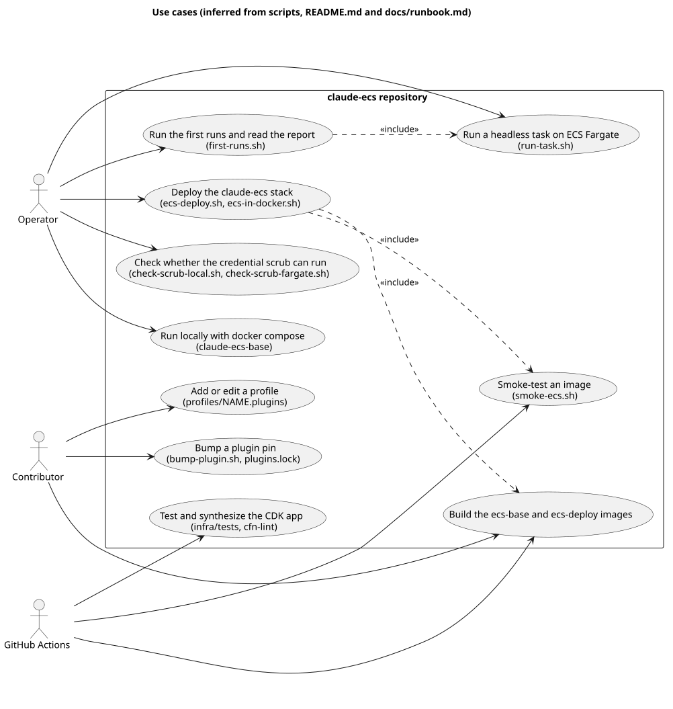

# Documentation index

Documentation for the repository that builds Claude Code container images and runs them on AWS ECS Fargate (`README.md:1-3`).

## Documents

| Document | Contents |
|---|---|
| [Architecture overview](architecture.md) | Parts, images, runtime behavior, CDK resources, operator tooling, CI, security posture, inconsistencies noticed |
| [API reference](api-reference.md) | Container, command-line, environment, file-format and CDK interfaces. The source defines no network API, and the document says so |
| [Onboarding guide](onboarding.md) | Prerequisites, first hour, common changes, deployment gotchas, how to send a change |

## Diagrams

Each diagram has a source file and a rendered SVG side by side in `diagrams/`.

| Diagram | Type | Files |
|---|---|---|
| Components of claude-ecs | Component (PlantUML) | `diagrams/architecture-components.puml`, `diagrams/architecture-components.svg` |
| AWS resources of the stack | Deployment (PlantUML) | `diagrams/aws-deployment.puml`, `diagrams/aws-deployment.svg` |
| Use cases, inferred | Use case (PlantUML) | `diagrams/use-cases-inferred.puml`, `diagrams/use-cases-inferred.svg` |
| ecs-claude startup | Activity (PlantUML) | `diagrams/ecs-claude-startup.puml`, `diagrams/ecs-claude-startup.svg` |
| run-task.sh sequence | Sequence (Mermaid) | `diagrams/run-task-sequence.mmd`, `diagrams/run-task-sequence.svg` |
| Image build flow | Flowchart (Mermaid) | `diagrams/image-build-flow.mmd`, `diagrams/image-build-flow.svg` |
| Classes in infra | Class (Mermaid) | `diagrams/infra-classes.mmd`, `diagrams/infra-classes.svg` |
| Deploy stack status | State (Mermaid) | `diagrams/deploy-stack-status.mmd`, `diagrams/deploy-stack-status.svg` |
| Preflight verdict | State (Mermaid) | `diagrams/preflight-verdict.mmd`, `diagrams/preflight-verdict.svg` |

The architecture overview embeds most of these. The use case diagram is an inference from the scripts, `README.md` and `docs/runbook.md`, not something the source states:

No entity-relationship diagram is provided because the source defines no database tables (see section 8 of the architecture overview).

## How these documents were made

Every statement cites a `path:line` in the repository. Where the source does not say, the text says "not determined from the source". Commands quoted in the onboarding guide come from the repository's own documentation and were not run while writing it.

## Sources

README.md
infra/app.py
infra/stacks/claude_ecs_stack.py
scripts/run/run-task.sh
scripts/deploy/ecs-deploy.sh
scripts/deploy/ecs-in-docker.sh
docs/runbook.md
