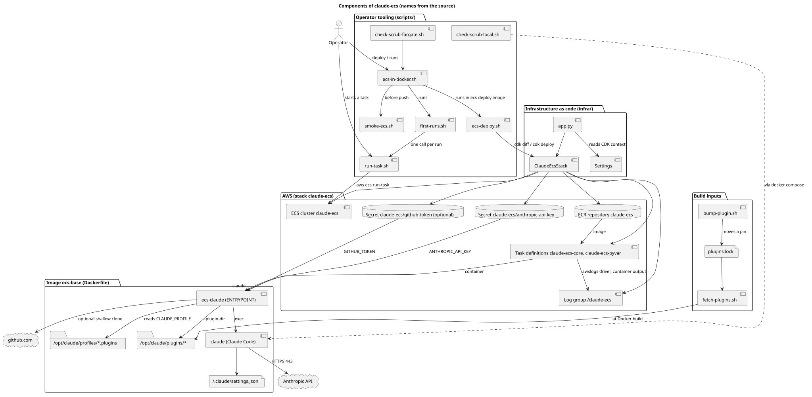
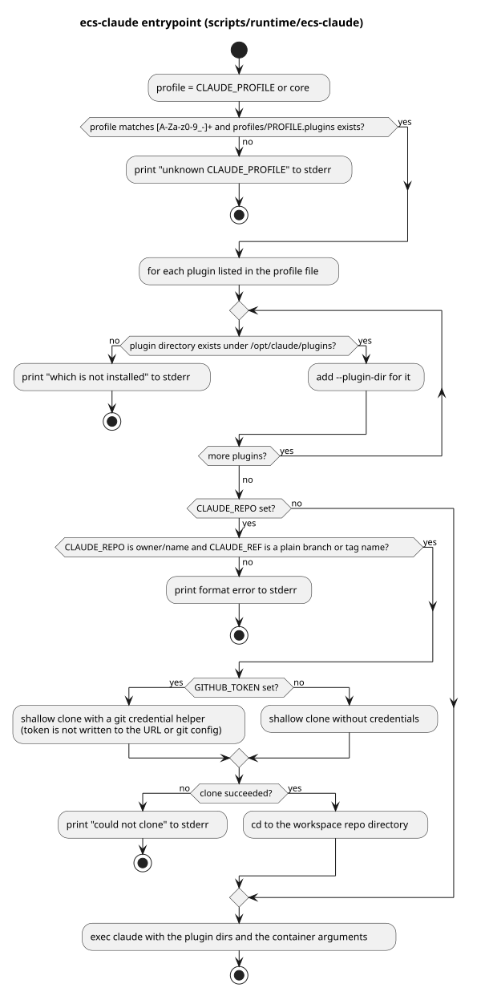
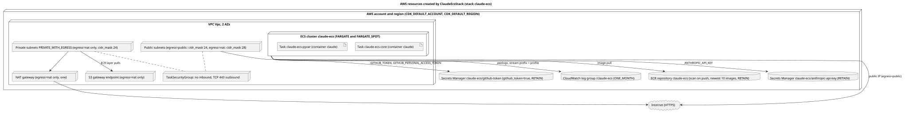
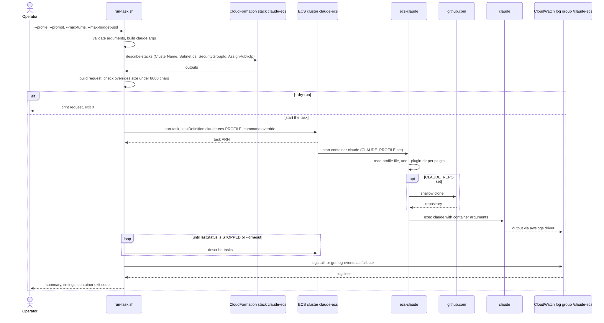

# Architecture overview

This repository builds container images that run Claude Code headlessly, and a CDK app and set of shell scripts that run those images as one-off tasks on AWS ECS Fargate (`README.md:3`). It is a build, deploy and operate toolkit. It contains no long-running service and no application server code of its own (see [API reference](api-reference.md) for what it exposes instead).

Every claim below carries a `path:line` reference into the repository. Where the source does not say, this document says "not determined from the source".

## 1. Parts at a glance

| Part | What it is | Where |
|---|---|---|
| Images | Two Docker targets: `ecs-base` and `ecs-deploy` | `Dockerfile:36`, `Dockerfile:139`, `README.md:9-12` |
| Entrypoint | `ecs-claude`, a bash wrapper that selects plugins, optionally clones a repository, then runs `claude` | `scripts/runtime/ecs-claude:1-62`, `Dockerfile:134` |
| Plugins and profiles | `plugins.lock` pins plugins by commit; `profiles/NAME.plugins` chooses a subset per run | `plugins.lock:1-30`, `profiles/core.plugins:1-12`, `profiles/pyvar.plugins:1-12` |
| User-level config | One baked-in settings file for Claude Code | `claude-config/settings.json:1-37`, `Dockerfile:108` |
| Infrastructure | CDK app with one stack, `claude-ecs` | `infra/app.py:36-44`, `infra/stacks/claude_ecs_stack.py:83` |
| Operator scripts | Start tasks, deploy the stack, run first-run experiments, probe the credential scrub | `scripts/run/`, `scripts/deploy/` |
| CI | Two GitHub Actions workflows | `.github/workflows/build-ecs.yml:1`, `.github/workflows/infra.yml:1` |
| Articles | Prose and HTML write-ups, not code | `articles/` |

Diagram source: `diagrams/architecture-components.puml`.

## 2. The container images

The Dockerfile has two stages. Docker builds the last stage when no `--target` is given, so the default target is `ecs-deploy`; the README tells readers to always name a target (`Dockerfile:4-5`, `README.md:7`).

Diagram source: `diagrams/image-build-flow.mmd`.

### `ecs-base`

- Starts from `node:22-slim` (`Dockerfile:36`).
- Installs `git`, `curl`, `ca-certificates`, `jq`, `bubblewrap` and `socat` with apt (`Dockerfile:43-50`), then the GitHub CLI from its apt repository (`Dockerfile:53-60`).
- Gets Python 3.12 from `uv` (pinned at `ghcr.io/astral-sh/uv:0.12.23`) into a venv at `/opt/venv` with `awscli`, `boto3`, `pytest` and `ruff` (`Dockerfile:66-73`).
- Creates the non-root user `claude` with uid 1001 (`Dockerfile:76-78`).
- Installs Claude Code through npm at `CLAUDE_CODE_VERSION`, default `2.1.294` (`Dockerfile:41`, `Dockerfile:81-82`).
- Fetches plugins with `scripts/build/fetch-plugins.sh` from `plugins.lock` into `/opt/claude/plugins`, owned by root. The optional `github_token` is a BuildKit secret mount, not a build argument (`Dockerfile:89-99`).
- Copies `profiles/` to `/opt/claude/profiles/` and `scripts/runtime/ecs-claude` to `/usr/local/bin/ecs-claude` (`Dockerfile:102-103`).
- Copies `claude-config/` to `/home/claude/.claude/` and writes a minimal `~/.claude.json` inline (`Dockerfile:108-111`).
- Switches to `USER claude`, sets `DISABLE_AUTOUPDATER=1`, `CLAUDE_CODE_SKIP_ONBOARDING=1`, `CLAUDE_CODE_SUBPROCESS_ENV_SCRUB=0` and `PYTHONUNBUFFERED=1`, then sets `WORKDIR /workspace`, `ENTRYPOINT ["ecs-claude"]` and `CMD []` (`Dockerfile:113-135`).

### `ecs-deploy`

Built `FROM ecs-base`. It adds the AWS CDK CLI and Python library, the Stripe CLI (version from `STRIPE_CLI_VERSION`, default `1.53.0`) and the AWS Session Manager plugin, then returns to `USER claude` (`Dockerfile:139-174`).

### Build context

`.dockerignore` is an allowlist: only `claude-config`, `profiles`, `plugins.lock`, `scripts/build/fetch-plugins.sh` and `scripts/runtime/ecs-claude` enter the build context (`.dockerignore:4-9`).

## 3. Runtime behavior

### Entrypoint

`ecs-claude` reads `CLAUDE_PROFILE` (default `core`), checks it against `^[A-Za-z0-9_-]+$` and the existence of `profiles/NAME.plugins`, and exits 2 if either fails (`scripts/runtime/ecs-claude:16-25`). For each non-comment line of the profile file it requires a directory under the plugins directory and adds `--plugin-dir` for it, exiting 2 when one is missing (`scripts/runtime/ecs-claude:27-33`).

When `CLAUDE_REPO` is set it must look like `owner/name`; `CLAUDE_REF`, if set, must be a plain branch or tag name that does not start with `-`. Failures exit 2 (`scripts/runtime/ecs-claude:35-44`). It then makes a shallow clone into `/workspace/repo`, using a git credential helper when `GITHUB_TOKEN` is set so the token is not placed in the URL or git config, and exits 3 if the clone fails (`scripts/runtime/ecs-claude:45-58`). Finally it runs `exec claude` with the plugin directories followed by the container arguments (`scripts/runtime/ecs-claude:62`).

Diagram source: `diagrams/ecs-claude-startup.puml`.

### Profiles and plugins

- `plugins.lock` lists `NAME REPO SHA PATH` per plugin, 12 entries from five repositories (`plugins.lock:1-30`). `fetch-plugins.sh` insists on a full 40-character SHA, a `.claude-plugin/plugin.json` whose `name` equals the lock name, and no duplicates (`scripts/build/fetch-plugins.sh:19-46`).
- `profiles/core.plugins` lists 10 plugins and `profiles/pyvar.plugins` lists the same 10 plus `fastapi` (`profiles/core.plugins:3-12`, `profiles/pyvar.plugins:2-12`).
- `frontend-mobile-development` is in `plugins.lock:23` but in neither profile file. It is installed in the image and loaded by no profile (`profiles/core.plugins:3-12`, `profiles/pyvar.plugins:2-12`).
- `scripts/build/bump-plugin.sh NAME` moves every lock entry that shares that repository and commit to the head of the repository's default branch (`scripts/build/bump-plugin.sh:9-26`).

### Claude Code settings

`claude-config/settings.json` sets the default model `claude-sonnet-5-5`, per-model effort levels, `"defaultMode": "bypassPermissions"`, and a few `env` values such as `CLAUDE_CODE_MAX_OUTPUT_TOKENS` (`claude-config/settings.json:2-7`, `claude-config/settings.json:8-27`, `claude-config/settings.json:28-30`). The smoke test checks that the user-level directory contains settings only, with no `agents`, `commands`, `skills`, `hooks` or `plugins` (`scripts/ci/smoke-ecs.sh:53-61`).

## 4. Infrastructure (CDK)

`infra/app.py` reads CDK context keys into a `Settings` dataclass, adds the profile names found in `profiles/*.plugins`, and creates one stack named `claude-ecs` (`infra/app.py:23-44`). `ClaudeEcsStack` builds the following (`infra/stacks/claude_ecs_stack.py`):

| Resource | Detail | Line |
|---|---|---|
| ECR repository `claude-ecs` | scan on push, keep newest 10 images, `RETAIN` | `:89-96` |
| VPC | 2 AZs; shape depends on `egress` | `:98`, `:164-195` |
| Security group `TaskSecurityGroup` | `allow_all_outbound=False`; one egress rule, TCP 443 to any IPv4; no ingress | `:103-110` |
| ECS cluster `claude-ecs` | Fargate capacity providers enabled | `:112-118` |
| Log group `/claude-ecs` | one month retention, `DESTROY` | `:120-126` |
| Secret `claude-ecs/anthropic-api-key` | placeholder value, `RETAIN`, injected as `ANTHROPIC_API_KEY` | `:197-207` |
| Secret `claude-ecs/github-token` | only when `github_token` is true; injected as `GITHUB_PERSONAL_ACCESS_TOKEN` and `GITHUB_TOKEN` | `:208-219` |
| One Fargate task definition per profile | family `claude-ecs-PROFILE`, container `claude`, environment `CLAUDE_PROFILE`, awslogs with the profile as stream prefix, stop timeout 30 s, init process enabled | `:129-154` |
| Stack outputs | `RepositoryUri`, `ClusterName`, `SubnetIds`, `SecurityGroupId`, `AssignPublicIp`, `TaskDefinitionFamilies` | `:156-162` |

Diagram source: `diagrams/infra-classes.mmd`. The module-level helpers `parse_tags` and `profile_names` are functions, not classes, so they are described in the [API reference](api-reference.md) and not drawn here.

Diagram source: `diagrams/aws-deployment.puml`.

### Egress modes

- `public` (default): public subnets only, no NAT gateway, `AssignPublicIp` output `ENABLED` (`infra/stacks/claude_ecs_stack.py:166-177`, `infra/stacks/claude_ecs_stack.py:161`).
- `nat`: public and private subnets, one NAT gateway, an S3 gateway endpoint to keep ECR layer pulls off the NAT, output `DISABLED` (`infra/stacks/claude_ecs_stack.py:178-195`).
- Neither mode filters outbound traffic by domain; `infra/README.md:27` and `docs/runbook.md:131` say `egress=nat` alone filters nothing.

### Tests

`infra/tests/test_claude_ecs_stack.py` asserts on the synthesized template: one task definition per profile, no inbound rule and HTTPS-only outbound, NAT and subnet counts per mode, secrets retained and placeholder-only, task roles with no managed policies, ECR scanning and retention, and invalid `Settings` rejected (`infra/tests/test_claude_ecs_stack.py:45-219`).

## 5. Operator tooling

| Script | Role | Evidence |
|---|---|---|
| `scripts/run/run-task.sh` | Starts one task, waits for `STOPPED`, prints logs, exit code and timings | `scripts/run/run-task.sh:1-13`, `:186-233` |
| `scripts/deploy/ecs-deploy.sh` | Guarded deploy: `preflight`, `stack`, `image`, `secret`, `verify` | `scripts/deploy/ecs-deploy.sh:5-14`, `:534-553` |
| `scripts/deploy/ecs-in-docker.sh` | Runs the same flow with only Docker on the host, through the `ecs-deploy` image | `scripts/deploy/ecs-in-docker.sh:5-9`, `:141-157` |
| `scripts/run/first-runs.sh` | Fixed set of runs against a deployed stack with a markdown report | `scripts/run/first-runs.sh:5-35`, `:73-91` |
| `scripts/run/check-scrub-local.sh` | Probes whether Claude Code's credential scrub can run in the reader's Docker | `scripts/run/check-scrub-local.sh:5-31` |
| `scripts/run/check-scrub-fargate.sh` | Same probe as three Fargate tasks | `scripts/run/check-scrub-fargate.sh:5-34` |
| `scripts/run/scrub-verdict.sh` | Shared probe prompt and classifier, sourced by the two checks | `scripts/run/scrub-verdict.sh:1-15`, `:17-30`, `:36-78` |
| `scripts/ci/smoke-ecs.sh` | Smoke tests for a built image | `scripts/ci/smoke-ecs.sh:1-12` |

### Starting a task

`run-task.sh` validates its arguments (profile pattern, exactly one of prompt or prompt file, numeric `--max-turns` and `--max-budget-usd`), reads the stack outputs unless all four `CLAUDE_ECS_*` infrastructure variables are set, builds one `aws ecs run-task` request with a command override and optional `CLAUDE_REPO`/`CLAUDE_REF` environment overrides, refuses overrides of 8000 characters or more, and polls until the task is `STOPPED` (`scripts/run/run-task.sh:82-116`, `:119-161`, `:186-200`).

Diagram source: `diagrams/run-task-sequence.mmd`.

### Deploying

`ecs-deploy.sh stack` runs `cmd_preflight`, then `cdk diff`, and refuses to deploy unless the diff only creates resources in the `claude-ecs` stack. It then asks for the account id to be typed (or relies on `ASSUME_YES=1` with `EXPECTED_ACCOUNT`) before `cdk deploy` (`scripts/deploy/ecs-deploy.sh:404-453`). It never runs `cdk bootstrap` (`scripts/deploy/ecs-deploy.sh:13`).

Diagram source: `diagrams/preflight-verdict.mmd`.

`ecs-in-docker.sh deploy` builds both images, smoke-tests `ecs-base`, branches on the CloudFormation stack status, stores the Anthropic key if the secret still holds the placeholder, pushes the image and runs `verify` (`scripts/deploy/ecs-in-docker.sh:239-266`).

Diagram source: `diagrams/deploy-stack-status.mmd`.

### First runs and guardrails

`first-runs.sh` accepts only the `core` and `pyvar` profiles, requires turn and budget caps on every run, requires prompts to start with `Read-only:`, limits parallelism to 3 tasks and refuses to start when the summed budgets exceed `--max-total-usd` (default 5) or when tasks are already running in the cluster (`scripts/run/first-runs.sh:44-45`, `:93`, `:153-164`, `:195-196`). Tasks it started are stopped on exit (`scripts/run/first-runs.sh:124-146`).

## 6. CI

- `build-ecs.yml` runs on pull requests that touch build inputs (and on manual dispatch). It builds `ecs-base` and `ecs-deploy` with Buildx and runs `smoke-ecs.sh` on each (`.github/workflows/build-ecs.yml:20-32`, `:47-85`). Third-party actions are pinned by commit SHA (`.github/workflows/build-ecs.yml:48`, `:53`, `:56`).
- `infra.yml` runs on pull requests that touch `infra/`, `profiles/`, `scripts/run/`, `scripts/deploy/` or `scripts/runtime/`. Job `cdk` runs pytest, synthesizes both egress modes and runs `cfn-lint`. Job `scripts` runs `shellcheck` and the stub-based script tests (`.github/workflows/infra.yml:10-19`, `:28-103`).
- Neither workflow deploys anything or uses AWS credentials (`.github/workflows/infra.yml:3-6`, `infra/README.md:47`).

## 7. Security posture and known limits

These are stated in the source and not independently verified here.

- Permission checks are bypassed for the agent, intentionally, because a headless run cannot answer prompts (`claude-config/settings.json:28-31`, `SECURITY.md:60-64`).
- The API key is in the environment of every command the agent runs. `CLAUDE_CODE_SUBPROCESS_ENV_SCRUB=1` would hide it, but the image leaves it off because `bubblewrap` could not create a namespace in the Fargate task, per the project's measurements (`Dockerfile:115-127`, `README.md:22`, `docs/runbook.md:124`).
- Outbound HTTPS is open to any host by default (`README.md:139`, `docs/runbook.md:131`).
- The prompt, repository name and `--env` values are part of the ECS request and visible to anyone who can call `ecs:DescribeTasks` (`SECURITY.md:65-68`, `docs/runbook.md:136`).
- Each task role starts with no permissions; the execution role can pull from this repository, write to the log group and read this stack's secrets (`infra/README.md:20`, `infra/tests/test_claude_ecs_stack.py:133-154`).

## 8. Data model

The source defines no database tables or persistent schema, so no entity-relationship diagram is provided. The only stored state is in AWS resources created by the stack (ECR images, two secrets, log group) and the preflight baseline file `.ecs-deploy-baseline.json` written by `ecs-deploy.sh` (`scripts/deploy/ecs-deploy.sh:31`, `:367-371`).

## 9. Inconsistencies noticed in the source

- `infra/README.md:85` says the stack is "Not deployed or run", while `README.md:134` and `docs/runbook.md:5` say it is deployed and has run tasks.
- The default CPU architecture is `X86_64` in `Settings` (`infra/stacks/claude_ecs_stack.py:53`) but `ARM64` in `ecs-deploy.sh` (`scripts/deploy/ecs-deploy.sh:78`), which passes it to CDK as `cpu_architecture` (`scripts/deploy/ecs-deploy.sh:93`). A deploy through the script therefore differs from a bare `cdk deploy` unless the setting is given.
- `infra/README.md:12` says Container Insights is off; the stack code does not set it, so the value is the CDK default (not determined from the source).

## Sources

README.md
Dockerfile
.dockerignore
docker-compose.yml
plugins.lock
profiles/core.plugins
profiles/pyvar.plugins
claude-config/settings.json
scripts/runtime/ecs-claude
scripts/build/fetch-plugins.sh
scripts/build/bump-plugin.sh
scripts/ci/smoke-ecs.sh
scripts/run/run-task.sh
scripts/run/first-runs.sh
scripts/run/check-scrub-local.sh
scripts/run/check-scrub-fargate.sh
scripts/run/scrub-verdict.sh
scripts/deploy/ecs-deploy.sh
scripts/deploy/ecs-in-docker.sh
infra/app.py
infra/stacks/claude_ecs_stack.py
infra/tests/test_claude_ecs_stack.py
infra/README.md
.github/workflows/build-ecs.yml
.github/workflows/infra.yml
docs/runbook.md
SECURITY.md
